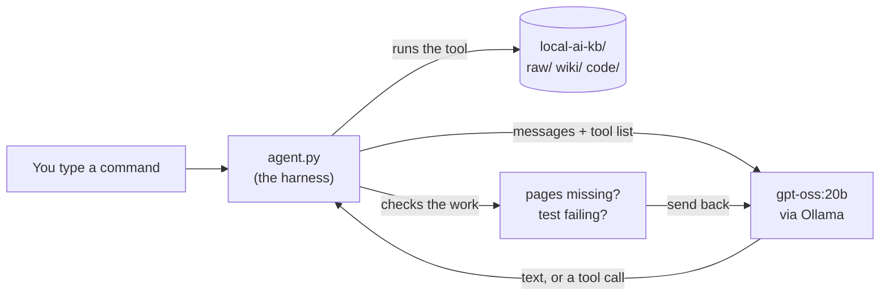

# the-layer-underneath

[](https://github.com/MatanElbaz/the-layer-underneath/actions/workflows/ci.yml)
[](LICENSE)

Run a language model on your own laptop, then give it a memory it can read, write and review: a small Python agent harness that keeps what it learns as a folder of markdown files you can open in Obsidian.

This is the companion code for the talk **The Layer Underneath: Local Models & Agent Memory**.

**Status: demo, not a product.** One model (`gpt-oss:20b` on Ollama), one scripted scenario, tested on one machine. See [Tested on](#tested-on) and [What this does not show](#what-this-does-not-show).

## Quick start

You need [Ollama](https://ollama.com/download) running, Python 3.9 or newer, git, about 16 GB of RAM and 13 GB of free disk. [Requirements](#requirements) has the details.

```bash
git clone https://github.com/MatanElbaz/the-layer-underneath.git
cd the-layer-underneath
./setup.sh        # pulls gpt-oss:20b if missing (13 GB), creates the workspace, loads the model
python3 agent.py
```

At the `you ›` prompt, type the commands below one after another. [docs/walkthrough.md](docs/walkthrough.md) explains each step, what to look for, and how to install everything from zero, including Obsidian.

## What you will do

The demo has two parts.

**Part 1: a model on your laptop.** Run the model with `ollama run`, see how long it takes, and check how much memory it holds with `ollama ps`. No network needed after the download.

**Part 2: give the agent a memory.** In `agent.py`, the harness is about 240 lines of Python with no dependencies. Its memory is a folder of markdown files.

| Step | You type | What happens |
|---|---|---|
| 1 | `!ask` | The wiki is empty, so the agent cannot answer. If it tries to read the raw sources, the harness blocks it. |
| 2 | `!ingest` | The agent reads three source files and writes six wiki pages. The harness checks which pages are missing and sends the agent back to write them. |
| 3 | `/new`, then `!ask` | The context is empty again, but the same question now gets an answer with `[[links]]` to the wiki pages. |
| 4 | `!add`, then `!lint` | A fictional forum post claims that `gpt-oss-20b` needs 32 GB. The agent finds that it contradicts the model card and writes `wiki/contradictions.md`. |
| 5 | `!code` | The agent writes `code/fit.py` using numbers from the wiki. The harness runs a test the agent cannot see, and sends failures back to be fixed. |
| 6 | `/exit`, then `python3 local-ai-kb/code/fit.py 24` | The generated code prints which model fits a 24 GB machine. |

Open `local-ai-kb/` as a vault in [Obsidian](https://obsidian.md/download) and keep its Graph view next to the terminal to watch the wiki grow.

## Requirements

| What | Needed |
|---|---|
| [Ollama](https://ollama.com/download) | Installed and running |
| Python | 3.9 or newer. Standard library only, nothing to `pip install` |
| git | Any recent version |
| Memory | About 16 GB. The model card says `gpt-oss-20b` runs within 16 GB, and `agent.py` adds a 16K-token context on top. Tested on 24 GB |
| Disk | 13 GB for the model |
| [Obsidian](https://obsidian.md/download) | Optional. Any markdown viewer works, or just `cat` |
| OS | `setup.sh` is a bash script: macOS or Linux, or WSL on Windows. Tested on macOS only |

Close memory-hungry apps first (Docker Desktop, many browser tabs). On a 24 GB Mac they made the demo about four times slower.

## Tested on

| Machine | Software | Result |
|---|---|---|
| MacBook, Apple M4, 24 GB, macOS 26.5.1 | Ollama 0.40.14, Python 3.9.6, `gpt-oss:20b` (12 GB in memory, 100% GPU) | In 3 of 3 full runs, plus one more from a fresh copy of this repository, every step completed and `!code` passed its test on the first try. The model generates roughly 22 to 25 tokens per second. The whole sequence took 177 to 200 seconds. |

Not tested: Linux, Windows, machines with less than 24 GB, other models.

## How it works



- **Context is not memory.** The context is the list of messages in the running process, and `/new` empties it. The memory is the `wiki/` folder, which stays on disk.
- **The model only asks.** It asks to call a tool, and the harness runs the tool, inside guard rails: it can write only to `wiki/` and `code/`, and during a question it cannot read `raw/` at all.
- **The rules live in a file.** `local-ai-kb/AGENTS.md` (from [`template/AGENTS.md`](template/AGENTS.md)) tells the agent how to ingest, answer, lint and write code. Edit it and the behaviour changes.

[docs/how-it-works.md](docs/how-it-works.md) goes through `agent.py` part by part.

## Repository layout

```text
agent.py               the harness (standard library only)
setup.sh               creates or resets the workspace, pulls the model, warms it up
template/              what setup.sh copies into the workspace
  AGENTS.md            the agent's rules
  raw/                 three short source files (model-card notes, quantization notes)
fixtures/              used by the demo, not by the agent
  act1-prompt.txt      the Part 1 prompt
  04-forum-post.md     the fictional forum post added by !add
  test_fit.py          the test that !code runs, kept outside the workspace
  fallback-wiki/       a wiki saved from a real run, for !restore
  fallback-code/       working code saved from a real run, for !restore
docs/                  walkthrough and how-it-works
tests/                 checks that run in CI (no model needed)
local-ai-kb/           the workspace, created by setup.sh (not in git)
```

## What this does not show

- **It is one model on one machine.** A 20B model is not deterministic. In our runs the wording changed every time, and `!lint` found the 32 GB claim in every run but missed the second contradiction in the forum post (12 GB against 19 GB) in 3 of 5 runs.
- **`!code` runs Python that the model wrote, on your machine, with no sandbox.** The generated file is about 35 lines and you can `cat` it before running it. Do not point this harness at tasks you would not run yourself.
- **A passing test proves only what the test checks.** `fixtures/test_fit.py` checks two model sizes, one function and the command-line output. It says nothing about the model's coding ability in general.
- **Ingest is tuned to the three sample sources.** The harness expects exactly the six pages listed in `REQUIRED` in `agent.py`. For your own sources, change `REQUIRED`, the `!ingest` prompt and `AGENTS.md` together.
- **The sample sources were summarised by hand** from the OpenAI and Qwen model cards, and each file says where its numbers come from. The forum post is fictional.

## Why this exists

Agent frameworks and note-taking assistants already exist, and the idea of an LLM that maintains a wiki is not mine. This repository does not claim a new idea. It tries to be the smallest version you can read in one sitting: one file of Python, one folder of markdown, and a harness that checks the model's work. Whether it is useful to anyone beyond the people who saw the talk is not yet known.

## Credits

- The "LLM Wiki" pattern (raw sources, a wiki the model maintains, and rules in a schema file): Andrej Karpathy, [LLM Wiki](https://gist.github.com/karpathy/442a6bf555914893e9891c11519de94f) (gist, April 2026).
- Models run through [Ollama](https://ollama.com). The notes in `template/raw/` summarise the model cards of `gpt-oss-20b` (OpenAI) and `Qwen3-Coder-30B-A3B` (Qwen team), both Apache 2.0.

## Contributing

Corrections and reports from other machines are welcome. See [CONTRIBUTING.md](CONTRIBUTING.md), or open an issue.

## License

[MIT](LICENSE).
